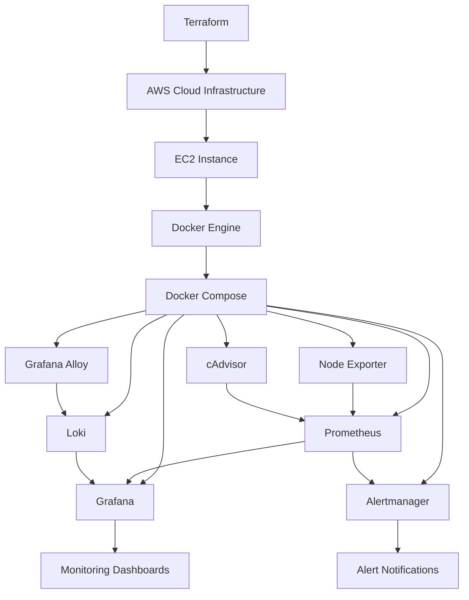

# Cloud Infrastructure Observability and Intelligent Incident Detection Platform

A cloud-based infrastructure monitoring and incident detection platform built using **AWS, Terraform, Docker, Prometheus, Grafana, Alertmanager, Loki and Grafana Alloy**.

The project provides centralized infrastructure monitoring, real-time metric visualization, log collection and automated alerting to help identify infrastructure and container-level issues.

---

## Project Overview

Modern cloud infrastructure requires continuous monitoring to maintain availability, performance and reliability.

This project implements an observability platform on AWS EC2 using containerized monitoring tools. It collects infrastructure metrics, visualizes system performance, monitors container health, centralizes logs and generates alerts when predefined thresholds or failure conditions are met.

The platform is deployed using Docker Compose, while Terraform is used to define and manage AWS infrastructure.

## Architecture



## Technologies Used

| Technology | Purpose |
|---|---|
| AWS EC2 | Cloud infrastructure hosting |
| AWS VPC | Network isolation |
| AWS IAM | Identity and access management |
| AWS Systems Manager | Secure instance access |
| Terraform | Infrastructure as Code |
| Docker | Containerization |
| Docker Compose | Container orchestration |
| Prometheus | Metrics collection and monitoring |
| Grafana | Monitoring dashboards and visualization |
| Alertmanager | Alert management and notifications |
| Node Exporter | Host-level metrics |
| cAdvisor | Container-level metrics |
| Loki | Centralized log storage |
| Grafana Alloy | Log collection and forwarding |
| Linux | Server administration |

## Monitoring Capabilities

### 1. Infrastructure Monitoring

Prometheus collects infrastructure metrics, including:

- CPU utilization
- Memory utilization
- Disk utilization
- Network traffic
- Network interface status
- Container availability

### 2. Container Monitoring

cAdvisor provides container-level resource metrics, while Node Exporter provides host-level metrics.

This helps monitor resource consumption and identify container availability problems.

### 3. Centralized Logging

Loki stores and indexes log data, while Grafana Alloy collects and forwards logs for centralized monitoring.

### 4. Grafana Dashboards

Grafana provides a centralized dashboard for visualizing infrastructure performance and monitoring metrics.

### 5. Automated Alerting

Prometheus evaluates predefined alert rules and sends firing alerts to Alertmanager.

## Prometheus Alert Rules

The platform implements seven alert rules:

| Alert | Condition | Duration |
|---|---|---|
| HighCPUUsage | CPU utilization above 80% | 5 minutes |
| HighMemoryUsage | Memory utilization above 80% | 5 minutes |
| HighDiskUsage | Disk utilization above 80% | 5 minutes |
| ContainerDown | Monitored container unavailable | 1 minute |
| NodeExporterDown | Node Exporter unavailable | 1 minute |
| HighNetworkTraffic | Network traffic above 100 Mbps | 2 minutes |
| NetworkInterfaceDown | Monitored network interface unavailable | 1 minute |

All seven alert rules were tested, and their notifications were verified through Alertmanager.

## AWS Infrastructure

The infrastructure includes:

- Custom AWS VPC
- Public and private subnets
- Internet Gateway
- Public and private route tables
- EC2 instance
- IAM role and instance profile
- Security group
- AWS Systems Manager access

Terraform configuration is maintained in the `terraform/` directory.

The deployed monitoring platform uses AWS EC2 in the `ap-southeast-2` region.

## Project Structure

```text
Cloud-Observability-Platform/
│
├── alertmanager/
│   └── alertmanager.yml
│
├── alloy/
│   └── config.alloy
│
├── grafana/
│   ├── dashboards/
│   └── provisioning/
│
├── loki/
│   └── loki-config.yml
│
├── prometheus/
│   ├── alerts.yml
│   └── prometheus.yml
│
├── terraform/
│   ├── ec2.tf
│   ├── iam.tf
│   ├── main.tf
│   ├── outputs.tf
│   ├── security-groups.tf
│   ├── variables.tf
│   ├── versions.tf
│   └── terraform.tfvars.example
│
├── docker-compose.yml
└── .gitignore
```

## Deployment

### Prerequisites

- AWS account
- AWS CLI
- Terraform
- Docker Engine
- Docker Compose
- Linux environment or WSL

### Step 1: Clone the repository

```bash
git clone https://github.com/AshwinSist/cloud-infrastructure-observability.git

cd cloud-infrastructure-observability
```

### Step 2: Configure AWS credentials

Configure your AWS CLI credentials and select the appropriate AWS region.

```bash
aws configure
```

### Step 3: Configure Terraform

Navigate to the Terraform directory.

```bash
cd terraform
```

Create your own `terraform.tfvars` using `terraform.tfvars.example` as a reference. Configure your AWS settings, instance type and deployment package S3 ARN.

### Step 4: Initialize and validate Terraform

```bash
terraform init
terraform fmt -recursive
terraform validate
```

Review the infrastructure plan before creating any AWS resources.

```bash
terraform plan
```

### Step 5: Deploy the monitoring stack

On the EC2 instance, navigate to the directory containing `docker-compose.yml`.

Start the monitoring services:

```bash
sudo docker compose up -d
```

Check container status:

```bash
sudo docker compose ps
```

## Testing and Validation

The platform was tested on AWS EC2.

Validation included:

- CPU utilization alert testing
- Memory utilization alert testing
- Disk utilization alert testing
- Container availability alert testing
- Node Exporter failure testing
- Network traffic alert testing
- Network interface alert testing
- Alert notification verification through Alertmanager
- Prometheus metrics verification
- Grafana dashboard persistence after restart
- Docker container status verification

All seven configured alert rules were tested, and their notifications were received through Alertmanager.

## Security Considerations

- AWS Systems Manager is used for secure instance access.
- Terraform state files and generated files are excluded from Git.
- AWS credentials and private keys must never be committed.
- Sensitive infrastructure values should be supplied through local configuration rather than hardcoded in source files.
- Monitoring interfaces should not be exposed publicly without appropriate security controls.

## Future Improvements

- Integrate additional cloud infrastructure metrics.
- Implement advanced incident correlation.
- Introduce intelligent anomaly detection.
- Integrate additional notification channels.
- Add automated CI/CD deployment.
- Implement long-term monitoring and log retention strategies.

## Author

**Ashwin V**

Cloud Computing | AWS | DevOps | Terraform | Docker | Linux | Monitoring and Observability

---

*This project demonstrates practical implementation of cloud infrastructure monitoring, containerized observability, Infrastructure as Code and automated incident alerting.*
